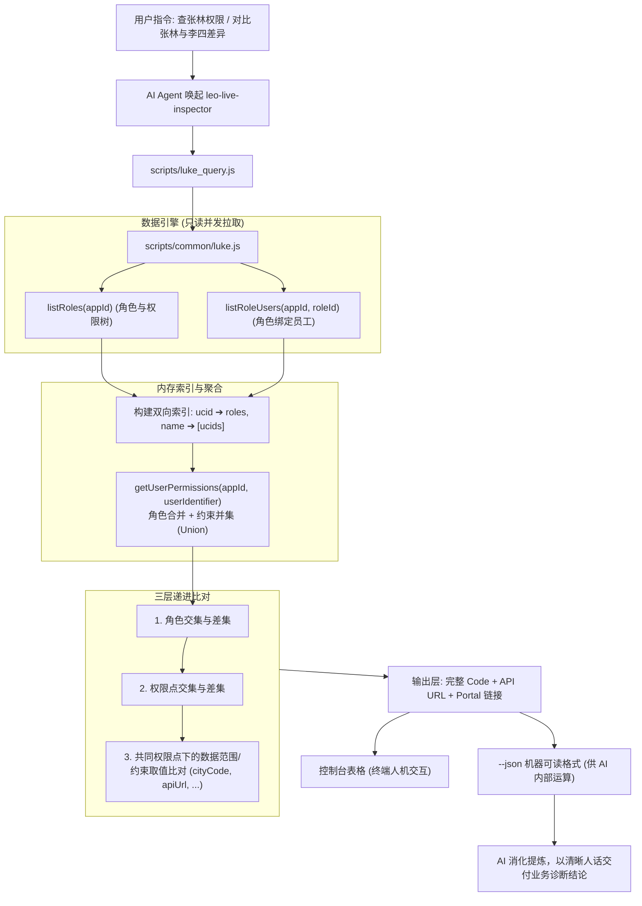

# Luke 人员权限画像与双人三层深度 Diff 方案规范 (Spec)

- **日期**：2026-10-28
- **目标组件**：`skills/leo-live-inspector`
- **状态**：已完成设计对齐，待进入实现阶段

---

## 1. 背景与业务诉求

在企业微服务与业务运维场景中，产研和运维团队经常遇到以下两类典型权限排查痛点：
1. **单人权限全景不可见**：“想知道某员工在当前业务系统（如 `iot_auth`）下具体有哪些权限、绑了哪些角色、数据范围是多大？”
2. **双人权限差异难以对比**：“员工 A 能查某接口或看某城市数据，但员工 B 查不到报错 403，两者配置到底差在哪里？”

由于权限系统（Luke）基于 RBAC 模型，权限点（Perm）挂载于角色（Role），且权限点上附带约束（Ext，如微服务 `serviceId`、城市 `cityCode`、接口 `apiUrl` 等）。目前缺少针对员工视角的权限聚合能力以及双人差异比对能力。

---

## 2. 核心目标与非目标

### 核心目标
1. **单人全景画像 (`user <ucid|name>`)**：
   - 支持工号（UCID）精确查询或员工姓名模糊查询（同名时列出候选工号消歧）；
   - 跨该员工名下所有角色，聚合出真实生效的权限点全集；
   - 对相同权限点的多角色约束自动执行**取值并集 (Union)**，真实反映其业务数据范围。
2. **双人三层递进 Diff (`diff-user <userA> <userB>`)**：
   - **第一层（角色层）**：对比 `[A独有角色]`、`[B独有角色]`、`[共有角色]`；
   - **第二层（权限点层）**：对比 `[A独有权限点]`、`[B独有权限点]`、`[共有权限点]`；
   - **第三层（约束/数据范围下探层）**：对共有权限点，深度比对关联约束（如城市、微服务、关联 API 等）的取值集合差集。
3. **直出完整 Code 与 URL**：
   - 严格直出角色 Code (`roleId`)、权限点 Code (`permId`)、约束 Code (`extId`) 以及关联的接口路径 (`apiUrl`)；
   - 提供 Luke 控制台直达 Web URL，方便产研一键复制到 Web 页面搜索或修改。
4. **AI 友好与自然语言转译**：
   - CLI 支持 `--json` 输出结构化机器格式，方便 AI 自动化提取分析；
   - CLI 默认文本模式输出彩色 Markdown 表格；
   - 并在 `SKILL.md` 中约束 AI **严禁直接向最终用户倾倒原始 JSON**，必须转译为业务人员一目了然的“人话”诊断结论。

### 非目标
- 本期不涉及跨多个不同 `appId` 的全局联合扫描（默认按指定 `--app`，默认 `iot_auth` 进行单系统深度排查）；
- 本期为纯只读探查，不涉及对人员角色的写操作或自动补权限（保持 Luke 两阶段风控原则）。

---

## 3. 架构设计与实现结构



### 修改与新增文件清单

| 文件 | 变更类型 | 核心职责 |
| :--- | :--- | :--- |
| `skills/leo-live-inspector/scripts/common/luke.js` | 增强 | 新增 `getUserPermissions`、`compareUserPermissions` 与 `resolveUserIdentifier` 核心聚合计算函数 |
| `skills/leo-live-inspector/scripts/luke_query.js` | 增强 | 新增 `user` 和 `diff-user` CLI 子命令路由与表格格式化 |
| `skills/leo-live-inspector/SKILL.md` | 增强 | 登记新能力与使用示例，注入【AI 交付与自然语言转译规范】 |
| `skills/leo-live-inspector/tests/luke-user-diff.test.mjs` | 新增 | 覆盖工号/姓名解析、单人权限聚合、三层 Diff 及 CLI 执行的完整测试套件 |

---

## 4. 详细接口与数据结构规范

### 4.1 单人画像返回结构 (`getUserPermissions`)

```json
{
  "user": {
    "ucid": "1000000030560224",
    "name": "张林"
  },
  "appId": "iot_auth",
  "env": "test",
  "roles": [
    {
      "id": "anjiah5:inventoryAdmin",
      "name": "安家H5-库存管理员",
      "active": true,
      "expireDate": "2099-12-31T23:59:59.000Z"
    }
  ],
  "perms": [
    {
      "id": "anjia:lock:infoView",
      "name": "门锁信息查看",
      "sourceRoles": ["anjiah5:inventoryAdmin"],
      "exts": {
        "cityCode": ["310000", "110000"],
        "apiUrl": ["/api/v1/locks/info", "/api/v1/locks/detail"]
      }
    }
  ]
}
```

### 4.2 双人 Diff 返回结构 (`compareUserPermissions`)

```json
{
  "userA": { "ucid": "1000000030560224", "name": "张林" },
  "userB": { "ucid": "1000000088888888", "name": "李四" },
  "appId": "iot_auth",
  "env": "test",
  "summary": {
    "roleCount": { "userA": 2, "userB": 1, "shared": 1 },
    "permCount": { "userA": 15, "userB": 10, "shared": 9 },
    "hasConstraintDiff": true
  },
  "rolesDiff": {
    "onlyA": [{ "id": "anjiah5:inventoryAdmin", "name": "安家H5-库存管理员" }],
    "onlyB": [],
    "both": [{ "id": "common:employee", "name": "安家H5-普通员工" }]
  },
  "permsDiff": {
    "onlyA": [
      {
        "id": "anjia:lock:delete",
        "name": "门锁删除",
        "sourceRoles": ["anjiah5:inventoryAdmin"],
        "exts": { "apiUrl": ["DELETE /api/v1/locks/:id"] }
      }
    ],
    "onlyB": [],
    "both": [
      {
        "id": "anjia:lock:infoView",
        "name": "门锁信息查看",
        "hasScopeDiff": true
      }
    ]
  },
  "constraintDiffs": [
    {
      "permId": "anjia:lock:infoView",
      "permName": "门锁信息查看",
      "extId": "cityCode",
      "extName": "城市编码",
      "scopeA": ["310000", "110000"],
      "scopeB": ["310000"],
      "onlyInA": ["110000"],
      "onlyInB": [],
      "explanation": "李四相比张林缺少城市约束: [110000] (北京)"
    }
  ]
}
```

---

## 5. AI 自然语言交付与用户沟通规范

当 AI 获取到上述比对数据后，**必须**按以下结构向用户进行自然语言汇报：

1. **核心结论先行**：第一句话直截了当回答差异根因（“A 拥有 XX 功能，而 B 缺少该功能”或“两者功能相同，但 B 缺少 XX 城市/微服务范围”）；
2. **结构化 Code 与 URL 标出**：
   - 角色：`` `anjiah5:inventoryAdmin` ``
   - 权限点：`` `anjia:lock:infoView` ``
   - 约束：`` `cityCode: [110000]` ``
   - 接口路径：`` `GET /api/v1/locks/info` ``
   - 控制台链接：方便产研一键在页面精准定位；
3. **修复与赋权建议**：如果这是报障对比，主动指出需要分配哪个角色或修改哪个权限点的约束。

---

## 6. 异常边界与错误处理

1. **同名员工消歧**：
   - 若姓名匹配到多名员工，返回 `{ ambiguous: true, candidates: [...] }`，AI 转用自然语言询问用户工号；
2. **员工无权限**：
   - 若某员工名下无任何角色，明确返回并友好提示“该员工在系统当前未绑定任何角色”；
3. **凭据失效**：
   - 自动联动 `browser_credentials.js` 从 Chrome 扩展探针提取凭据，若无则输出引导复制语句。
