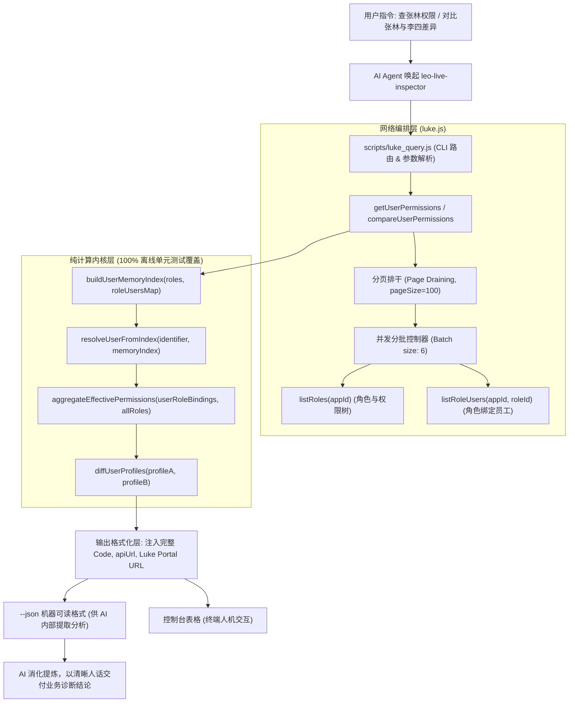

# Luke 人员权限画像与双人三层深度 Diff 方案规范 (Spec)

- **日期**：2026-10-28
- **目标组件**：`skills/leo-live-inspector`
- **状态**：已根据 Review 反馈完成修订，待执行计划

---

## 1. 背景与业务诉求

在企业微服务与业务运维场景中，产研和运维团队经常遇到以下两类典型权限排查痛点：
1. **单人权限全景不可见**：“想知道某员工在当前业务系统（如 `iot_auth`）下具体有哪些权限、绑了哪些角色、数据范围是多大？”
2. **双人权限差异难以对比**：“员工 A 能查某接口或看某城市数据，但员工 B 查不到报错 403，两者配置到底差在哪里？”

由于权限系统（Luke）基于 RBAC 模型，权限点（Perm）挂载于角色（Role），且权限点上附带约束（Ext，如微服务 `serviceId`、城市 `cityCode`、接口 `apiUrl` 等）。目前缺少针对员工视角的权限聚合能力以及双人差异比对能力。

---

## 2. 核心目标与非目标

### 核心目标
1. **单人全景画像 (`user <ucid|name>`)**：
   - 支持工号（UCID）精确查询或员工姓名模糊查询（同名时列出候选工号与所属角色列表进行消歧）；
   - 跨该员工名下所有**有效且未过期角色**，聚合出真实生效的权限点全集；
   - 对相同权限点的多角色约束自动执行**取值并集 (Union)**，真实反映其业务数据范围。
2. **双人三层递进 Diff (`diff-user <userA> <userB>`)**：
   - **第一层（角色层）**：对比 `[A独有角色]`、`[B独有角色]`、`[共有角色]`；
   - **第二层（权限点层）**：对比 `[A独有权限点]`、`[B独有权限点]`、`[共有权限点]`；
   - **第三层（约束/数据范围下探层）**：对共有权限点，深度比对关联约束（如城市、微服务、关联 API 等）的取值集合差集；
   - 明确定义零差异状态（当两人权限 100% 完全相同时给出明确报告）。
3. **直出完整 Code 与 Web 控制台 URL**：
   - 严格直出角色 Code (`roleId`)、权限点 Code (`permId`)、约束 Code (`extId`) 以及关联的接口路径 (`apiUrl`)；
   - 提供 Luke 控制台直达 Web URL（`portalUrl`），方便产研一键复制到 Web 页面搜索或在浏览器中直达修改。
4. **AI 友好与自然语言转译**：
   - CLI 支持 `--json` 输出结构化机器格式，方便 AI 自动化提取分析；
   - CLI 默认文本模式输出彩色 Markdown 表格；
   - 并在 `SKILL.md` 中约束 AI **严禁直接向最终用户倾倒原始 JSON**，必须转译为业务人员一目了然的“人话”诊断结论。

### 非目标
- 本期不涉及跨多个不同 `appId` 的全局联合扫描（默认按指定 `--app`，默认 `iot_auth` 进行单系统深度排查）；
- 本期为纯只读探查，不涉及对人员角色的写操作或自动补权限（保持 Luke 两阶段风控原则）。

---

## 3. 架构设计与分层解耦

为了确保可测试性（零网络依赖测试）与高稳定性，系统拆分为**计算内核层**与**网络编排层**：



### 3.1 核心纯计算函数设计（Hermetic Unit Testable）
1. `buildUserMemoryIndex(roles, roleUsersMap)`:
   - 输入全量角色列表与角色-人员映射，构建：
     - `ucidToRoles`: `Map<ucid, { user: { name }, roles: [roleSummary] }>`
     - `nameToUsers`: `Map<name, Array<{ ucid, name, roles: [roleId] }>>`
2. `resolveUserFromIndex(identifier, memoryIndex)`:
   - 支持工号直接匹配；
   - 若为姓名且匹配到唯一员工，直接返回；
   - 若为姓名且匹配到多名同名员工，返回 `{ ambiguous: true, candidates: [{ ucid, name, roles }] }`，带出各自名下绑定的角色；
   - 若未匹配到，返回 `{ notFound: true, identifier }`。
3. `aggregateEffectivePermissions(ucid, userRoles, allRolesMap)`:
   - 过滤失效或已过期角色（`active === false` 或 `roleExpireDate < now` 或 `userBindingExpireDate < now`）；
   - 聚合提取所有权限点（`permId`）；
   - 对相同权限点的 `exts` 执行**并集合并 (Union)**（例如 `apiUrl`、`cityCode` 取去重并集）；
   - 生成单人权限画像。
4. `diffUserProfiles(profileA, profileB)`:
   - 计算三层差集与交集：
     - 角色：`onlyA`, `onlyB`, `both`；
     - 权限点：`onlyA`, `onlyB`, `both`；
     - 约束下探：遍历 `both` 权限点，逐一比对约束数组。若存在差异记录为 `constraintDiffs`。
   - 若零差异，返回 `summary.isIdentical: true`。

### 3.2 网络编排与性能防护（Pagination & Concurrency）
1. **分页排干 (Page Draining)**：
   - 拉取角色列表时使用 `pageSize: 100`，若 `total > 100` 自动循环翻页拉全；
   - 拉取角色人员列表时同样排干分页，杜绝遗漏人员。
2. **并发分批控制 (Concurrency Pool)**：
   - 限制并发请求批次大小为 6 个，使用 `p-limit` 或分块循环，防止触发 Luke 后端限流或连接重置。

---

## 4. 详细接口、URL 模板与数据结构规范

### 4.1 Luke Web 控制台 URL 模板
- **测试环境**：`https://test-luke.ke.com/#/role/detail?appId=${appId}&id=${roleId}`
- **生产环境**：`https://luke.ke.com/#/role/detail?appId=${appId}&id=${roleId}`
- **权限点直达链接**：`https://${host}/#/perm/detail?appId=${appId}&id=${permId}`

---

### 4.2 单人画像返回结构 (`getUserPermissions`)

```json
{
  "user": {
    "ucid": "1000000030560224",
    "name": "张林"
  },
  "appId": "iot_auth",
  "env": "test",
  "roles": [
    {
      "id": "anjiah5:inventoryAdmin",
      "name": "安家H5-库存管理员",
      "active": true,
      "expireDate": "2099-12-31T23:59:59.000Z",
      "portalUrl": "https://test-luke.ke.com/#/role/detail?appId=iot_auth&id=anjiah5:inventoryAdmin"
    }
  ],
  "perms": [
    {
      "id": "anjia:lock:infoView",
      "name": "门锁信息查看",
      "sourceRoles": ["anjiah5:inventoryAdmin"],
      "portalUrl": "https://test-luke.ke.com/#/perm/detail?appId=iot_auth&id=anjia:lock:infoView",
      "exts": {
        "cityCode": ["310000", "110000"],
        "apiUrl": ["/api/v1/locks/info", "/api/v1/locks/detail"]
      }
    }
  ]
}
```

---

### 4.3 双人 Diff 返回结构 (`compareUserPermissions`)

```json
{
  "userA": { "ucid": "1000000030560224", "name": "张林" },
  "userB": { "ucid": "1000000088888888", "name": "李四" },
  "appId": "iot_auth",
  "env": "test",
  "summary": {
    "isIdentical": false,
    "roleCount": { "userA": 2, "userB": 1, "shared": 1 },
    "permCount": { "userA": 15, "userB": 10, "shared": 9 },
    "hasConstraintDiff": true
  },
  "rolesDiff": {
    "onlyA": [
      {
        "id": "anjiah5:inventoryAdmin",
        "name": "安家H5-库存管理员",
        "portalUrl": "https://test-luke.ke.com/#/role/detail?appId=iot_auth&id=anjiah5:inventoryAdmin"
      }
    ],
    "onlyB": [],
    "both": [
      {
        "id": "common:employee",
        "name": "安家H5-普通员工",
        "portalUrl": "https://test-luke.ke.com/#/role/detail?appId=iot_auth&id=common:employee"
      }
    ]
  },
  "permsDiff": {
    "onlyA": [
      {
        "id": "anjia:lock:delete",
        "name": "门锁删除",
        "sourceRoles": ["anjiah5:inventoryAdmin"],
        "portalUrl": "https://test-luke.ke.com/#/perm/detail?appId=iot_auth&id=anjia:lock:delete",
        "exts": { "apiUrl": ["DELETE /api/v1/locks/:id"] }
      }
    ],
    "onlyB": [],
    "both": [
      {
        "id": "anjia:lock:infoView",
        "name": "门锁信息查看",
        "hasScopeDiff": true,
        "portalUrl": "https://test-luke.ke.com/#/perm/detail?appId=iot_auth&id=anjia:lock:infoView"
      }
    ]
  },
  "constraintDiffs": [
    {
      "permId": "anjia:lock:infoView",
      "permName": "门锁信息查看",
      "extId": "cityCode",
      "extName": "城市编码",
      "scopeA": ["310000", "110000"],
      "scopeB": ["310000"],
      "onlyInA": ["110000"],
      "onlyInB": [],
      "explanation": "李四相比张林缺少城市约束: [110000] (北京)"
    }
  ]
}
```

---

### 4.4 同名消歧结构 (Ambiguity Schema)

当输入姓名匹配到多名员工时，CLI 返回如下 JSON（退出码 0，带 `ambiguous: true`）：

```json
{
  "ambiguous": true,
  "query": "张林",
  "appId": "iot_auth",
  "message": "系统中检索到多名同名员工，请使用精准工号重新查询",
  "candidates": [
    {
      "ucid": "1000000030560224",
      "name": "张林",
      "roles": ["anjiah5:inventoryAdmin", "common:employee"]
    },
    {
      "ucid": "1000000088888888",
      "name": "张林",
      "roles": ["device:operator"]
    }
  ]
}
```

---

### 4.5 CLI 命令行接口规范

在 `scripts/luke_query.js` 中：
- `parseArgs` 升级：提取 `positional[0]` (command), `positional[1]` (targetId / userA), `positional[2]` (targetId2 / userB)。
- 子命令 1：`node scripts/luke_query.js user <ucid|name> [--app <appId>] [-e test|prod] [--json]`
- 子命令 2：`node scripts/luke_query.js diff-user <userA> <userB> [--app <appId>] [-e test|prod] [--json]`

#### 终端默认文本表格输出样式
```text
================================================================================
🔍 [测试环境] 人员权限差异对比报告: 张林 vs 李四 (App: iot_auth)
================================================================================

📌 概览统计:
   • 角色差异: 张林 2 个 | 李四 1 个 | 共同角色 1 个
   • 权限点差异: 张林 15 个 | 李四 10 个 | 共同权限点 9 个
   • 约束差异: 存在 1 项数据范围差异

🎭 角色差异对比 (Role Diff):
┌──────────┬──────────────────────────┬──────────────────────┬────────────────────────────────────────────────────────┐
│ 差异状态 │ 角色 Code                │ 角色名称             │ 控制台直达链接                                         │
├──────────┼──────────────────────────┼──────────────────────┼────────────────────────────────────────────────────────┤
│ [A 独有] │ anjiah5:inventoryAdmin   │ 安家H5-库存管理员    │ https://test-luke.ke.com/#/role/detail?id=...          │
│ [共有]   │ common:employee          │ 安家H5-普通员工      │ https://test-luke.ke.com/#/role/detail?id=...          │
└──────────┴──────────────────────────┴──────────────────────┴────────────────────────────────────────────────────────┘

🔐 约束与数据范围深度下探 (Constraint Scope Diff):
┌─────────────────────┬──────────────────┬──────────────────────┬──────────────────────┬─────────────────────────────┐
│ 权限点 Code         │ 权限点名称       │ 张林范围 (User A)    │ 李四范围 (User B)    │ 差异说明                    │
├─────────────────────┼──────────────────┼──────────────────────┼──────────────────────┼─────────────────────────────┤
│ anjia:lock:infoView │ 门锁信息查看     │ 310000, 110000       │ 310000               │ 李四缺少城市范围: [110000]  │
└─────────────────────┴──────────────────┴──────────────────────┴──────────────────────┴─────────────────────────────┘
```

---

## 5. AI 自然语言交付与用户沟通规范

当 AI 获取到上述比对数据后，**严禁直接倾倒 JSON**，必须按以下结构向用户进行自然语言汇报：

1. **核心结论先行**：第一句话直截了当回答差异根因（“李四查不到的原因是缺少北京数据范围”或“李四缺少门锁管理权限”）；
2. **结构化 Code 与 URL 标出**：
   - 角色：`` `anjiah5:inventoryAdmin` ``
   - 权限点：`` `anjia:lock:infoView` ``
   - 约束：`` `cityCode: [110000]` ``
   - 接口路径：`` `GET /api/v1/locks/info` ``
   - 控制台链接：方便产研一键在页面精准定位；
3. **修复与赋权建议**：如果这是报障对比，主动指出需要分配哪个角色或修改哪个权限点的约束。

---

## 6. 自动化测试套件设计 (`tests/luke-user-diff.test.mjs`)

测试用例完全基于静态 Mock 夹具（Fixtures），100% 离线可重放：
1. **同名消歧与工号解析测试**：
   - 测试工号精准匹配；
   - 测试同名返回带 `roles` 的候选列表；
   - 测试未知用户返回 `notFound`。
2. **权限画像聚合与约束合并测试**：
   - 验证多角色重叠权限点时的约束并集（`cityCode`、`apiUrl`）；
   - 验证已过期角色或绑定被自动过滤。
3. **三层 Diff 引擎算法测试**：
   - 测试单人有权限单人空权限；
   - 测试角色相同但权限点不同；
   - 测试权限点相同但约束范围不同；
   - 测试 100% 相同配置（`isIdentical: true`）。
4. **CLI 命令行格式化测试**：
   - 验证 `user` 子命令在 `--json` 与文本表格模式的输出完整性；
   - 验证 `diff-user` 子命令包含完整的 Code、URL 与差异说明。
